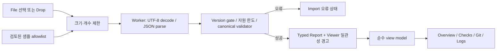

# JSON Report Viewer v0.1 아키텍처

2026-10-20 설계안. 구현 파일은 생성하지 않았다. [요구사항](VIEWER_REQUIREMENTS.md)의 P0를 대상으로 하며 기존 CLI와 schemaVersion=1을 변경하지 않는다.

## 1. 스택 비교와 결정

| 대안 | 유지보수·테스트 | 번들/운영 | 판단 |
| --- | --- | --- | --- |
| React + TypeScript + Vite | Import 상태, 검사 목록, 로그 펼침/검색을 컴포넌트와 reducer로 분리. Testing Library/Vitest 및 브라우저 E2E 조합 가능 | React/DOM 런타임 비용이 있지만 정적 산출물만 필요. Pages 하위 경로 지원 | **선택**. 화면 수보다 상태·오류·접근성 회귀 관리의 이점이 큼 |
| Vanilla TypeScript + Vite | 초기 구성은 단순. DOM 갱신·이벤트 정리·포커스·경쟁 상태를 직접 관리해야 함 | 프레임워크 런타임이 없어 더 작은 기본 번들 기대 | 단순 읽기 화면에는 적합. 이번 검색·오류·테마·접근성 상태의 수작업 비용이 큼 |
| HTML/CSS + ES modules, 빌드 없음 | 의존성은 적지만 TypeScript·스키마 코드 생성·모듈 테스트 도구는 별도 필요 | 가장 단순한 호스팅. 중복 스키마 관리 위험 | canonical JSON Schema 검증과 타입 안전성을 유지하려면 결국 빌드 도구가 필요해 제외 |

비교의 크기 평가는 정성적이며 번들을 실제 측정한 결과가 아니다. 초기 목표는 앱 초기 JS/CSS gzip 합계 250 KiB 이하(공개 샘플 제외); 구현에서 실제 측정하고 초과 시 원인과 조정안을 보고한다. SSR, 라우터, 전역 상태 라이브러리, UI kit, 차트·Markdown·ANSI→HTML 라이브러리는 필요하지 않다. React state/reducer, semantic HTML, 일반 CSS 변수를 사용한다.

검증 도구는 Ajv 2020 + ajv-formats의 **빌드 시 standalone validator 생성**을 선택한다. 런타임에 임의 스키마를 컴파일하지 않으므로 `new Function`/unsafe-eval을 요구하지 않게 할 수 있다. [Ajv standalone 공식 문서](https://ajv.js.org/standalone.html).

React는 기본 텍스트 노드 렌더링만 사용한다. `dangerouslySetInnerHTML`은 금지한다. 프레임워크를 쓰는 것만으로 URL/CSS 속성이나 다른 DOM sink가 안전해지는 것은 아니다. [React DOM 문서](https://react.dev/reference/react-dom/components/common).

## 2. 디렉터리와 의존성 경계

아래는 **향후 생성할 구조**다.

```text
viewer/
  package.json                 # private: true, 독립 scripts/dependencies
  package-lock.json            # 루트 npm workspace 등록 없음
  index.html                   # production CSP meta, lang=ko
  tsconfig.json
  vite.config.ts
  scripts/
    generate-validator.mjs     # ../docs/report.schema.json을 읽기만 함
    verify-samples.mjs         # allowlist, 출처·해시·민감정보 검토 기록 확인
  src/
    app/                       # App, import reducer, theme, error boundary
    import/                    # file policy, worker controller, import.worker
    report/                    # 타입 전용 bridge, 검증 결과, 순수 view model
    generated/                 # standalone validator; 로컬 생성물
    components/                # ImportPanel, Overview, CheckList/CheckCard,
                               # LogPanel, GitChanges, Diagnostics, ExamplePicker
    styles/                    # CSS tokens, responsive styles
  samples/                     # 별도 승인·검토된 공개 사본과 manifest
  tests/                       # parser/adapter/컴포넌트 테스트, 합성 fixtures
  e2e/                         # Playwright: browser/security/base-path
  dist/                        # 이 디렉터리만 Pages artifact
.github/workflows/
  viewer-ci.yml                # 후속 구현: PR/push 검증, 배포 권한 없음
  viewer-pages.yml             # 후속 별도 승인: 수동 배포
```

Viewer는 루트 `src/report/types.ts`의 Report를 **type-only import**로 참조할 수 있다. JSON Schema는 루트의 파일 하나를 빌드 입력으로 읽는다. CLI 실행 코드, Node 전용 모듈, dist, package dependency를 런타임 import하지 않는다. Viewer의 TS는 bundler module resolution/DOM lib를 사용하고 CLI의 NodeNext 설정과 분리한다. root build 없이 viewer 폴더 설치·빌드가 가능해야 한다.

루트 package.json/lockfile, npm scripts, files allowlist(`dist`, schema, README, LICENSE), CLI runtime dependencies를 수정하지 않는다. viewer의 독립 package와 lockfile은 **후속 구현 승인 뒤** 생성한다. gitignore 추가가 필요하면 그때 viewer 내부 ignore 파일로 처리한다. 실제 루트 `vitest.config.ts`의 include는 `tests/**/*.test.ts`이고 root tsconfig include는 `src/**/*.ts`다. `viewer/tests/*.spec.ts(x)`와 Viewer 전용 설정으로 분리하여 기존 루트 실행에 들어가지 않게 한다. 기존 테스트를 약화하거나 삭제하지 않는다.

## 3. 데이터 흐름과 타입 계약



입력은 unknown이다. 선택 이벤트마다 증가하는 request ID를 부여하고 새 입력/닫기 시 이전 Worker를 종료한다. 늦게 도착한 이전 결과는 ID로 폐기한다. Worker 성공 결과를 받은 후에만 typed Report로 승격한다. ErrorBoundary의 메시지에도 데이터 원문·stack·사용자 경로를 남기지 않는다.

처리 순서:

1. 파일 하나인지, 10 MiB 이하인지 확인한다. MIME/확장자만으로 유효성을 판정하지 않는다.
2. File/Blob을 Worker에 전달한다. TextDecoder의 UTF-8 오류를 구분하고 선두 BOM 한 개는 허용한다. JSON.parse 오류는 원문 조각 대신 일반 설명과 가능한 경우 위치만 표시한다.
3. root object와 schemaVersion을 확인한다. 숫자 1은 검증 진행, 다른 숫자는 UnsupportedVersion, 누락/잘못된 타입은 SchemaError다.
4. 반복형 순회로 깊이/노드/목록 용량을 제한한다. 객체를 전역 설정에 merge하지 않으며 `Object.assign` 등의 prototype pollution 경로를 만들지 않는다. 5초 deadline이면 Worker를 종료하고 ResourceLimitError를 표시한다.
5. 빌드에 포함된 고정 validator로 v1 검증한다. 원본의 `$schema`/`$ref`를 따라 외부에 접근하지 않는다. coerceTypes/useDefaults/removeAdditional은 모두 사용하지 않는다. strictness는 canonical schema의 실제 키워드에 맞추며 additionalProperties=false를 그대로 유지한다. uuid/date-time format과 pattern, 안전한 정수 범위, nullable 조건을 검증한다.
6. 검증 오류는 instancePath+keyword 중심으로 최대 20개, 경로 표시 길이도 제한해 보여준다. 사용자 원문 값은 오류에 복제하지 않는다. 실패한 입력은 보고서 UI에 부분 렌더링하지 않는다.
7. 성공 시 Report를 한 번 전달하고 Worker를 종료하여 파싱 문자열·중간 객체를 해제한다. 주 스레드는 한 보고서만 보관한다. 안전한 표시용 view model을 원본과 분리하고 저장/변형하지 않는다.

canonical JSON Schema SHA-256(검토 시점): `debe5766f0538be9eb25434029f9b23ef9bc3716d7827eb04b6459b0750ec115`. 검증 코드 생성은 이 파일에서 수행하며 TS interface나 UI 필요에 맞춰 별도 스키마를 수작업 복제하지 않는다. [Ajv draft 2020-12 지원](https://ajv.js.org/json-schema.html).

Schema는 필드별 형식을 검증하지만 summary 합계와 checks 길이, 상태/종료 코드 관계, id 중복 등을 모두 교차 검증하지 않는다. Viewer는 명확한 합계·길이·상태 pair 불일치를 별도 경고할 수 있다. 이 경고는 CLI errors/warnings에 합치거나 정상 수치로 보정하지 않는다. 선택 실패와 전체 passed, 개별 exitCode=2와 check fail, error 시 errors=[]는 오탐 경고 대상이 아니다. React key는 외부 id 하나를 그대로 신뢰하지 않고 배열 위치와 결합한다.

## 4. 화면 컴포넌트 경계

| 모듈 | 책임 |
| --- | --- |
| App/import reducer | empty/loading/ready/import-error 상태, 활성 출처, request ID, 닫기·교체 |
| ImportPanel/ExamplePicker | 파일 선택·drop·예제 선택, 키보드 동등 경로, 진행 안내 |
| Overview/Diagnostics | 기록된 값과 진단 출력; 평가 error와 Import 오류 분리 |
| CheckList/CheckCard | 원래 검사 순서 유지, 100개 단위 페이지, kind/required/status 및 선택 필드 |
| LogPanel | lazy 펼침, 32,768 문자 단위 표시, 평문 청크 검색, 일치 위치, 잘림 플래그 |
| GitChanges | null/disabled/enabled 세 상태, 변경 목록·통계·위반 링크(화면 내부 이동만) |
| report view model | 상태 라벨·시간 포맷·누락/빈 값 구분. 점수·판정·테스트 수를 생성하지 않음 |

검색은 사용자 정규식이 아닌 literal substring으로 처리한다. 검색 옵션은 대소문자 구분 여부만 허용하고 debounce 200ms, 반복 청크 처리로 긴 문자열도 UI를 장시간 막지 않게 한다. `<mark>`도 텍스트 조각을 React children으로 렌더링한다. ‘1,000개 이상’은 검색 UI 한도이며 원본 로그가 잘렸다는 뜻이 아니다. 전체 로그를 한 번에 DOM으로 만드는 ‘모두 펼치기’는 제공하지 않는다.

## 5. 위협 모델과 개인정보

가장 중요한 위협은 보고서 문자열이 XSS나 외부 요청 URL이 되는 것, 민감 로그의 자동 저장/전송, 비정상 JSON으로 브라우저가 멈추는 것이다.

| 위험 | 통제와 확인 |
| --- | --- |
| HTML/JS 삽입 | 모든 데이터는 text node. innerHTML/dangerouslySetInnerHTML, Markdown/ANSI HTML 변환, eval, 명령 실행 금지. ``, script, SVG payload E2E |
| 경로/URL/명령 악용 | JSON 값을 href/src/style/className/DOM id로 직접 사용하지 않음. 자동 링크·로컬 파일 열기·외부 이미지 없음. command args를 문자열 텍스트로만 표시 |
| ANSI/제어 문자·bidi 위장 | 표시용 텍스트에서 ESC/제어·방향 제어 문자를 가시적인 이스케이프로 표현. 원본 데이터는 메모리에서 유지하고 표시 변환을 안내. 손상된 문자를 복구했다고 주장하지 않음 |
| 개인정보 전송 | fetch/XHR/WebSocket/sendBeacon/analytics/crash reporter 없음. 외부 CDN/폰트/스크립트 없음. 사용자 문자열로 network URL 생성 금지 |
| 보관/노출 | localStorage/sessionStorage/IndexedDB/Cache Storage/service worker에 보고서 저장 안 함. console에도 미기록. 테마도 세션 메모리만. 닫기 시 참조와 입력값 정리 |
| 과도한 자원 사용 | file.size 선확인, Worker/deadline, 반복형 깊이·노드 제한, 페이지 단위 DOM, 검색 한도, malformed/deep/긴 한 줄 테스트 |
| 정적 샘플 누출 | allowlist/manifest, 명시적 공개 사본, 자동 패턴 검사+사람의 내용 검토. docs 전체 폴더 복사 금지 |
| 공급망/호스트 | lockfile·고정 Actions SHA·최소 권한·정적 산출물 검사. 악성으로 교체된 호스팅 JS나 확장 프로그램까지 보호한다고 주장하지 않음 |

Production CSP는 meta로 가능한 범위를 사용한다. 기본안: `default-src 'none'; script-src 'self'; worker-src 'self'; style-src 'self'; img-src 'self'; font-src 'self'; connect-src 'none'; object-src 'none'; base-uri 'none'; form-action 'none'`. inline scripts/styles 및 unsafe-eval/unsafe-inline은 허용하지 않는다. React style prop 대신 CSS class를 쓰고 Vite module preload가 connect-src와 충돌하면 production module preload를 끄는 쪽으로 해결한다. Worker와 lazy sample module이 배포 CSP에서 로드되는지 E2E로 확인한다.

GitHub Pages에서 임의 응답 헤더를 설정할 수 있다고 가정하지 않는다. CSP meta가 지원하지 않는 frame-ancestors 등 헤더 전용 기능을 보장하지 않으며 anti-framing까지 완료했다고 주장하지 않는다. 개발 서버 HMR은 별도 개발 정책이며 production 보안 검증은 preview/static artifact에서 한다. [MDN CSP](https://developer.mozilla.org/en-US/docs/Web/HTTP/Guides/CSP), [Worker 동작](https://developer.mozilla.org/en-US/docs/Web/API/Web_Workers_API/Using_web_workers).

공개 샘플은 빌드 시 JSON import를 통해 별도 정적 module chunk로 포함한다. 예제 선택에 따라 신뢰된 고정 chunk만 로드하고 샘플 JSON URL을 fetch하지 않는다. 따라서 connect-src none을 유지할 수 있다. 앱 자산/샘플 JS 요청은 호스팅 접근 로그에 남을 수 있지만 사용자 파일 내용/파일명/검색어를 요청에 포함하지 않는다. local File 읽기는 서버 업로드가 아니다. 브라우저 메모리의 즉각적인 물리적 삭제나 브라우저 자체 swap/crash dump까지 보장하지 않는다.

## 6. 샘플 출처와 익명화

mini-lang 4개는 현재 이미 `<experiment>` 경로 치환 및 ANSI 제거를 거친 **공유용 사본**이다. 이를 raw original이라고 부르지 않는다. 원래 임시 프로젝트는 실험 후 정리됐으므로 raw JSON을 새로 확보했다고 주장하지 않는다. 현재 로컬 근거 파일은 그대로 두고, 공개 승인 이후 `viewer/samples/`에 별도 사본을 준비한다.

manifest는 sample ID, 제목, 원본 상대 경로·SHA-256, 실제 실행/합성 여부, 치환 목록, 공개 사본 SHA-256, 검토 날짜를 가진다. CLI JSON envelope에 메타데이터를 삽입하지 않는다. 점수·상태·시간·UUID·검사 수를 임의 수정하지 않는다. 추가 익명화가 필요한 문자열만 치환하고 schema와 기대 수치를 다시 검증한다.

이번 설계 검토의 홈 경로/npm·GitHub 토큰·private-key 패턴 검사에서는 후보 JSON에 발견 사항이 없었다. 패턴 무검출은 모든 비밀정보 부재의 보장이 아니며, 프로젝트명·파일명·코드 조각·로그 내용의 공개 적합성은 별도 검토한다. 기본 공개 샘플에 direct-command-results/verification-summary나 전체 실험 디렉터리를 통째로 포함하지 않는다.

## 7. 개발·빌드·GitHub Pages

향후 viewer 폴더에서 `npm ci`, `npm run dev`, `npm run typecheck`, `npm test`, `npm run test:e2e`, `npm run build`, `npm run preview`를 정의한다. build는 validator 생성과 샘플 검사 후 TypeScript/Vite를 실행한다. Playwright는 Chromium/Firefox/WebKit으로 production artifact를 검사한다. Node 24를 기본 개발/Viewer CI 런타임으로 하고 정확한 도구 버전은 착수 때 engines/보안 상태를 확인해 pin한다. 현재 Node 24.16.0에 미래 최신 Vite가 반드시 설치된다고 가정하지 않는다.

예정 URL은 `https://jebipro.github.io/agent-eval-lab/`, Vite production base는 `/agent-eval-lab/`이다. root-relative `/assets` 경로를 하드코딩하지 않는다. 정적 자산과 Worker는 Vite가 해석하는 URL/import를 사용하고 필요할 때 `import.meta.env.BASE_URL`을 이용한다. history router를 쓰지 않으므로 새로고침용 404 fallback은 필요 없다. URL fragment에는 고정 섹션 ID만 사용한다. [Vite 정적 배포 문서](https://vite.dev/guide/static-deploy.html).

배포는 기존 CLI CI와 독립 workflow다. PR/일반 push 검증은 contents:read만 사용하고 공개 배포를 실행하지 않는다. 최초 배포 및 Viewer v0.1 배포는 별도 승인 후 main의 workflow_dispatch로 제한한다. 같은 SHA의 viewer 검사와 기존 CLI 4환경 CI 성공을 확인한 뒤 `viewer/dist`만 Pages artifact로 올린다. deploy job에만 pages:write/id-token:write, needs=build, github-pages environment와 main 제한, concurrency를 둔다. npm token/게시 권한은 없다. Actions는 구현 시 확인한 공식 release SHA를 고정한다. [GitHub Pages custom workflow](https://docs.github.com/en/pages/getting-started-with-github-pages/using-custom-workflows-with-github-pages).

Pages 설정 변경, workflow 생성, 외부 배포는 이번에 하지 않았다. 공개 승인·환경 권한·샘플 공개 적합성 확인이 배포의 전제다.

## 8. 결정과 측정 대기

스택·폴더·계약·보안 경계·base 경로·수동 배포 전략은 결정했다. 버전 pin, 실제 gzip 크기/5초 한도 성능, production CSP와 Worker/module 동작, 모바일 Safari/Android 실제 파일 선택은 구현 중 검증할 항목이다. 합격 근거가 없으면 한도를 조용히 늘리거나 CSP를 완화하지 않고 원인과 대안을 보고한다. 새로운 API/서버/CLI schema 변경은 이 설계의 해결책으로 사용하지 않는다.
